# How CloudClean works

Flowcharts of what happens when CloudClean runs: from the server starting, to a button press, a live
scan, a chat with the assistant and an update reaching the DGX Spark. Every box names the file (and
usually the function) that does the step, so you can open it and read on.

- **Which file uses which**, file by file, is in [docs/repo-map.md](docs/repo-map.md). It is generated
  from the code (`python tools/repo_map.py`).
- **Why** it is built this way is in [DECISIONS.md](DECISIONS.md).
- Paths are relative to the repo. Backend files are under `cloudclean/`, frontend files under
  `frontend/src/`.

## Contents

1. [The whole system](#1-the-whole-system)
2. [Starting up](#2-starting-up)
3. [A button press: from the UI to a new model](#3-a-button-press-from-the-ui-to-a-new-model)
4. [A live scan with the MetroY](#4-a-live-scan-with-the-metroy)
5. [The turntable](#5-the-turntable)
6. [A chat with the assistant](#6-a-chat-with-the-assistant)
7. [Measuring and the golden model check](#7-measuring-and-the-golden-model-check)
8. [Photos](#8-photos)
9. [The screen: frontend structure](#9-the-screen-frontend-structure)
10. [Install, deploy and update](#10-install-deploy-and-update)
11. [Command line and autopilot](#11-command-line-and-autopilot)
12. [What is stored where](#12-what-is-stored-where)

Arrow labels: solid arrows are calls or data handed on, dotted arrows are network traffic, and boxes
marked *thread* or *process* run alongside the rest.

---

## 1. The whole system

One Python server (FastAPI) does everything. The browser only shows things and sends requests.
Heavy work runs in a separate worker process, so the server stays responsive. Hardware and the LLM are
reached from the server, never from the browser.

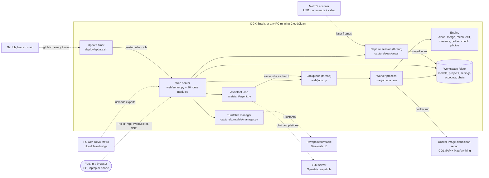

Three ways the browser and server talk:

- **Plain HTTP (`/api/...`)** for almost everything. A long operation answers at once with a *job*,
  and the browser polls `/api/jobs` until it is done.
- **One WebSocket (`/api/capture/stream`)** for the live scan: points, status and guidance, many times
  a second.
- **Server-Sent Events (`POST /api/assistant/chat`)** for the assistant's reply, streamed word by word
  with its tool calls.

---

## 2. Starting up

`cloudclean serve` builds the app, plugs in every feature module by name, and starts the background
threads. The browser then loads the prebuilt UI and asks who is signed in.

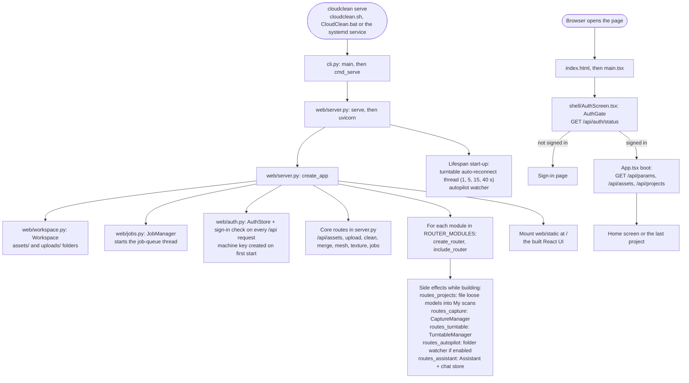

- **Job modules are not imported at start.** `web/jobs.py: job_function` imports the right
  `jobs_*.py` inside the worker process, the first time that kind of job runs.
- **Sign-in check (`require_sign_in`).** A request passes if it has a session cookie (`cc_session`) or
  the machine key header (`X-CloudClean-Key`, used by the bridge and the updater). Otherwise it gets
  `401 Sign in first`. The capture WebSocket checks the same thing itself.

---

## 3. A button press: from the UI to a new model

Every operation that changes or makes a model (Clean, Merge, Mesh, Edit, golden check, photos…)
follows this path. Clean is the example. Quick answers (measuring, status, export to a folder) skip the
job and answer straight away.

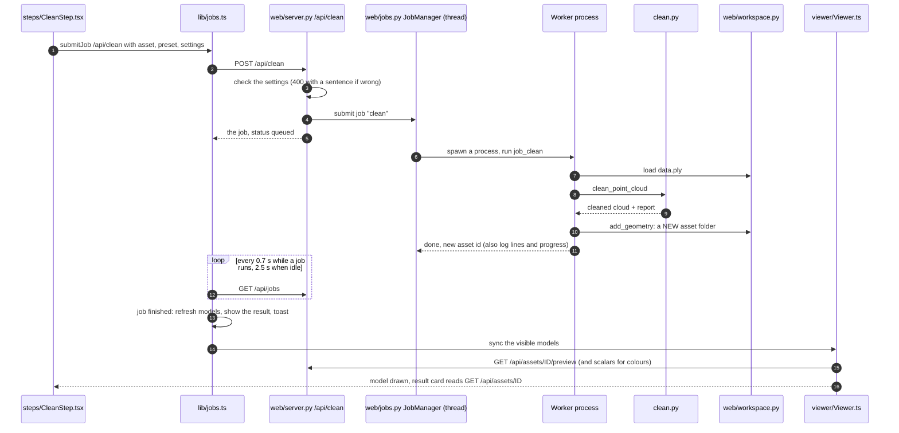

- **The original is never changed.** Every result is a new asset whose `parents` point back to what it
  was made from. That is also why the viewer never has to invalidate anything: new id, new model.
- **Where each operation goes:**

  | UI action | Route | Job kind | Job body | Engine |
  |---|---|---|---|---|
  | Clean | `/api/clean` | `clean` | `web/jobs.py` | `clean.py` |
  | Merge, check merge | `/api/merge`, `/api/merge/assess` | `merge`, `merge_assess` | `web/jobs.py`, `jobs_merge.py` | `register.py`, `markers.py` |
  | Mesh | `/api/mesh` | `mesh` | `web/jobs.py` | `mesh.py` |
  | Edit, Floor, true size, smooth | `/api/edit` | `edit` | `jobs_edit.py` | `edit.py` |
  | Export to the server | `/api/export` | none: answered at once | `jobs_edit.py: export_asset` | `io.py` |
  | Fill holes | `/api/holes/fill` | `fill_holes_selected` | `jobs_holes.py` | `holes.py` |

  The full list of routes and job kinds is in [docs/repo-map.md](docs/repo-map.md#job-kinds).
- **Cancel.** `POST /api/jobs/ID/cancel` removes a queued job, or stops the worker process of a
  running one.

---

## 4. A live scan with the MetroY

The scanner streams laser frames over USB. CloudClean turns each frame into 3D points in a pool of
processes, places it with the markers, averages it into the surface, and streams what it has to the
browser.

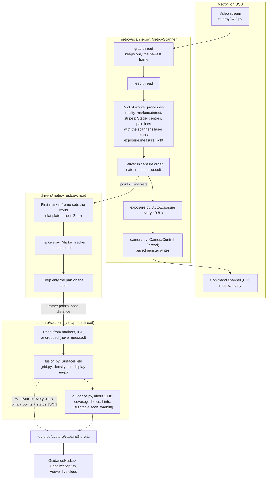

**Steps around the stream:**

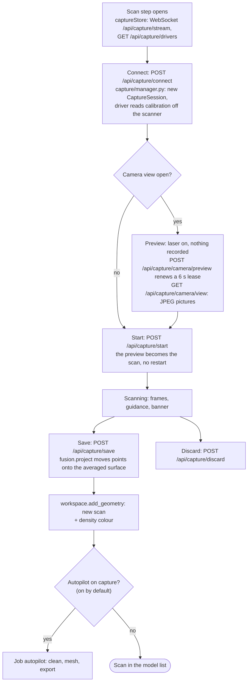

**Other scanners** use the same session:
- `simulated` makes frames of a known part.
- `realsense` / `orbbec` give frames without a pose; the session places them with ICP.
- `folder` and `revo_bridge` deliver whole scans. The Revo Metro PC runs `cloudclean bridge`
  (`capture/bridge.py`), which uploads each export to `/api/capture/bridge/upload`.
- Whole scans are checked against the first one (`register.assess_pair`). A doubtful scan waits for
  your decision (`/api/capture/pending/ID`).

---

## 5. The turntable

The browser polls the table's status and sends commands. The server keeps the Bluetooth link on its
own thread and can turn the table for as long as a scan runs.

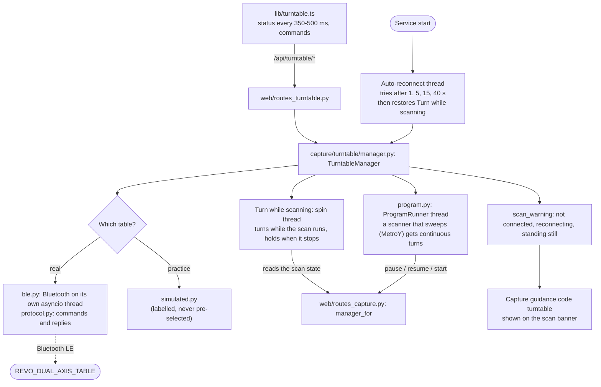

The table that was connected and the spin setting are remembered in `settings.json`, so a restart
(every update restarts the service) brings both back.

---

## 6. A chat with the assistant

The assistant is a loop: the model answers, may call tools, sees the results and answers again. Tools
use the same jobs and workspace as the buttons, and `ui` events move the app on screen.

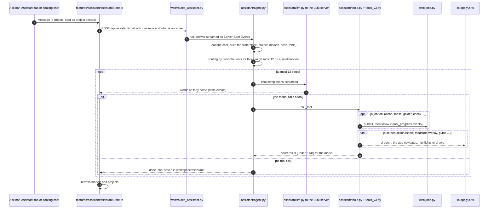

- **Guardrails** (`tools.py`): no scaling unless you ask; merge only after a check and your OK; delete
  only through a confirm card; exports never overwrite; the table only moves on request.
- **"Where is…?"** `app_guide` looks the feature up in `assistant/guide.py`, then `lib/guide.ts`
  navigates there and `ui/GuideSpotlight.tsx` rings the control.

---

## 7. Measuring and the golden model check

Quick measurements answer straight away. Comparisons that take longer run as jobs.

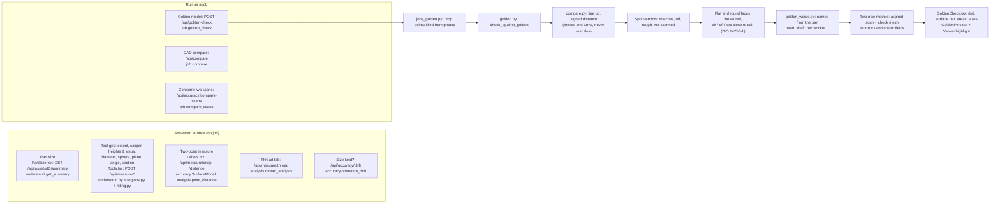

---

## 8. Photos

Photos are kept as project photos the moment they are added, and can then be used three ways.

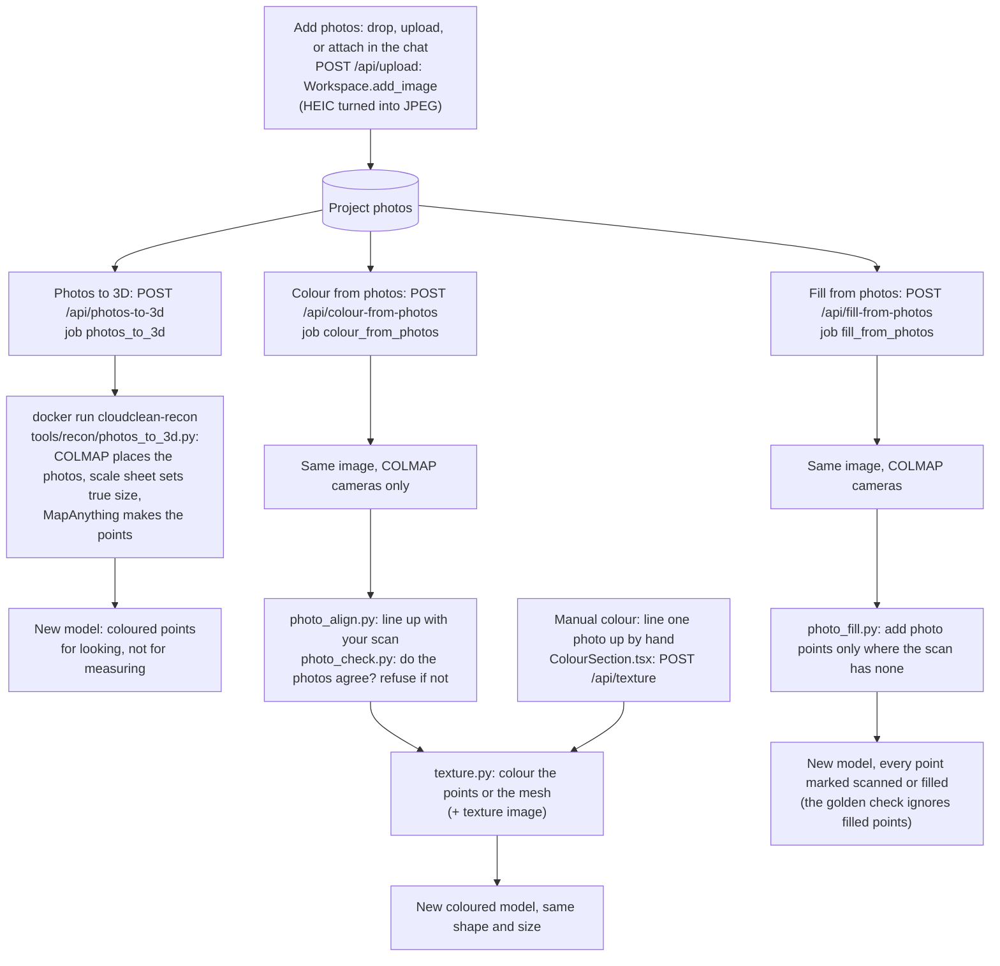

---

## 9. The screen: frontend structure

What is on screen, and where its data comes from.

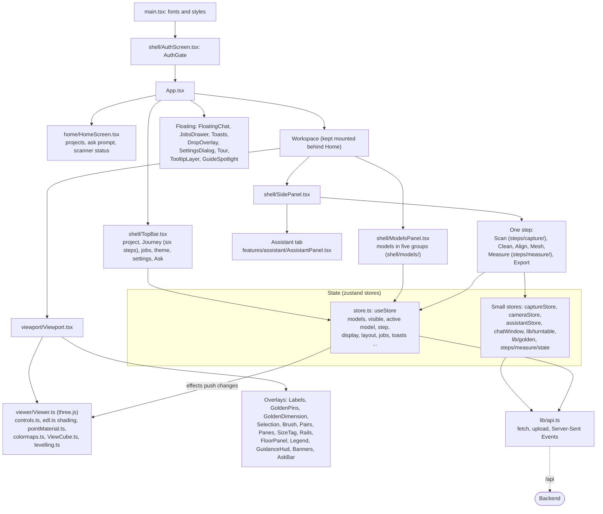

- **Polling:** jobs (`lib/jobs.ts`), the turntable status (`lib/turntable.ts`), the camera picture
  (`cameraStore.ts`).
- **Streaming:** the live scan (`captureStore.ts`, WebSocket) and chat replies (`assistantStore.ts`,
  Server-Sent Events).
- **Remembered per browser (localStorage `cloudclean.*`):** screen, step, project, theme, text size,
  layout, up axis, rotate style, units, shading.

---

## 10. Install, deploy and update

Code is edited on a PC, pushed to GitHub, and the Spark updates itself, but only when nothing is
running.

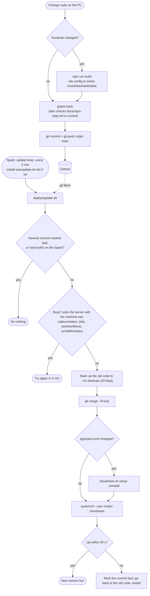

**First install on a machine:**
- `cloudclean.sh` (Linux, macOS, Spark) or `CloudClean.bat` (Windows) makes `.venv`, installs, and
  runs `cloudclean serve`.
- `deploy/install-service.sh` installs a systemd user service that starts at boot.
- `deploy/install-autoupdate.sh` installs the update timer.
- `sudo deploy/install-scanner-access.sh` lets the service open the MetroY with nobody logged in.
- Docker (`Dockerfile`, `compose.yaml`) is the alternative without USB, Bluetooth or photos → 3D.

---

## 11. Command line and autopilot

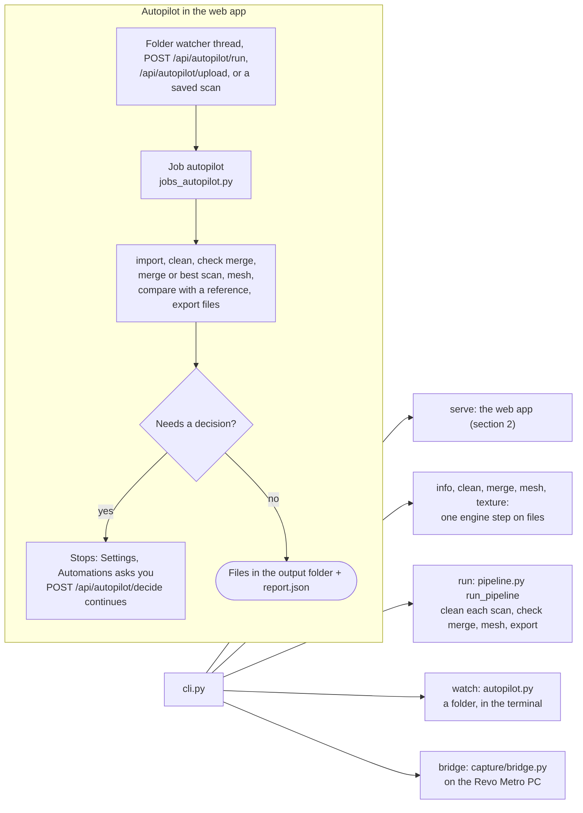

---

## 12. What is stored where

```text
<workspace>/                      ~/cloudclean-workspace on the Spark
├── assets/<12-hex id>/           one folder per model or photo, never changed after creation
│   ├── meta.json                 name, kind, operation, parents, params, stats, project, part frame
│   ├── data.ply                  full resolution
│   ├── preview.ply               what the browser loads (≤ 1.5 M points / ≤ 600 k triangles)
│   ├── report.json               what the operation did and measured
│   ├── scalars_<name>.npy        a value per point (deviation, density …) + .preview.bin for the browser
│   └── thumbnail.png, summary.json, markers.json, textured.glb, image.<ext> …
├── projects.json                 one project per physical part, golden model per project
├── settings.json                 one section per feature (capture, turntable, assistant, autopilot …)
├── auth/                         users, sessions (fingerprints only), activity log, machine_key
├── assistant/<id>.json           chats (no image data, only captions)
├── recon/<job>/                  photo reconstruction working folders
└── uploads/                      files being imported, bridge uploads
~/.cache/cloudclean/metroy/       scanner calibration per serial number, recordings for replay
```
